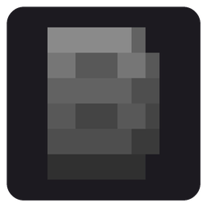
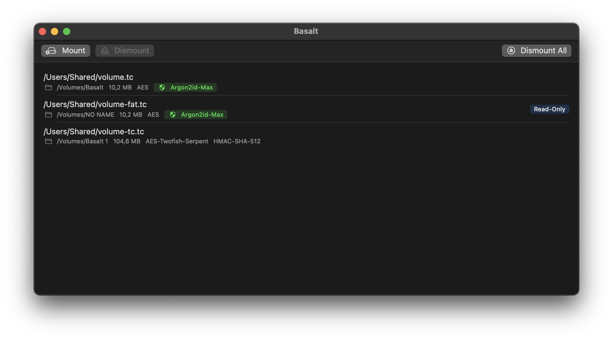
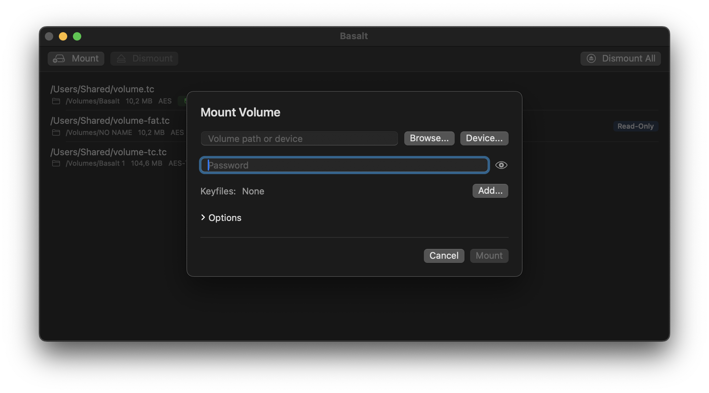
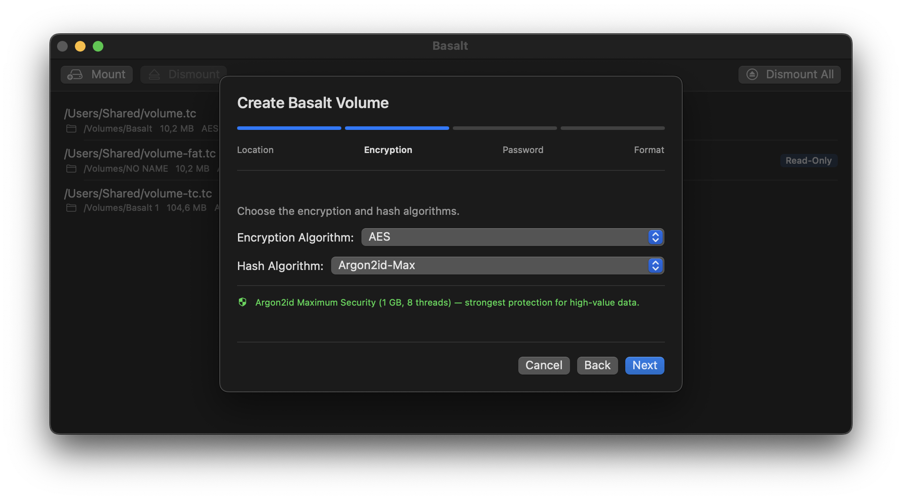
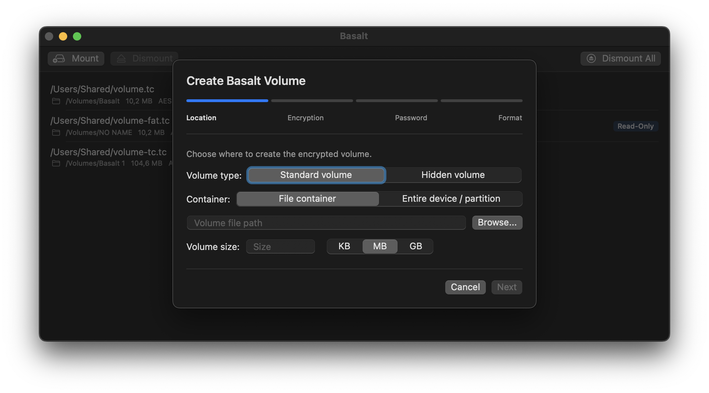
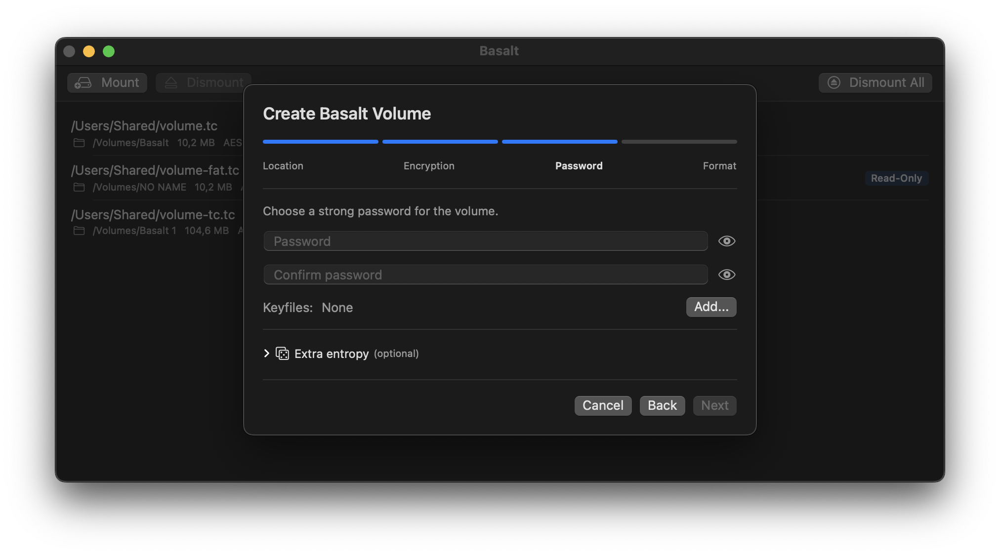
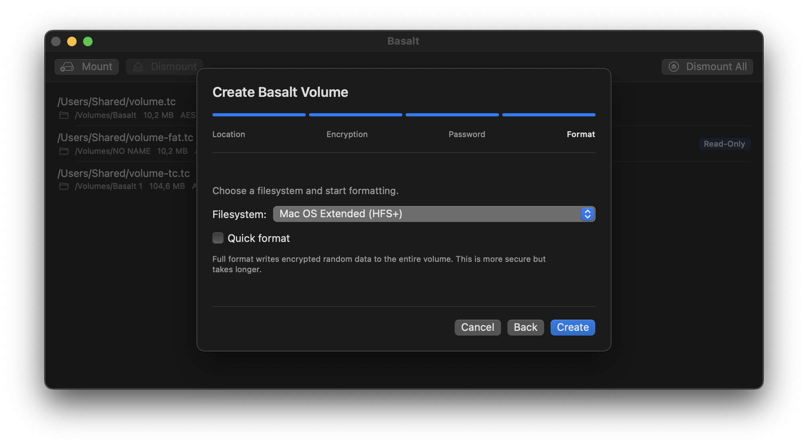
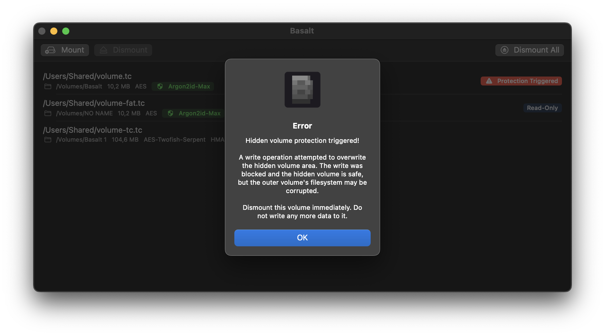

<p align="center">
  
</p>
<h1 align="center">Basalt</h1>
<p align="center">
  <strong>A security-hardened fork of TrueCrypt 7.1a for macOS</strong><br>
  Native SwiftUI app &middot; Argon2id key derivation &middot; DarwinFUSE (no kext) &middot; Universal Binary (arm64 + x86_64)
</p>
<p align="center">
  
  
</p>

---

TrueCrypt was abandoned in 2014. VeraCrypt continued it, but added questionable
ciphers, a complex PIM system, and a Windows bootloader signed by Microsoft.

Basalt takes a different path: fix what's broken, remove what shouldn't be there,
and build a native macOS app from scratch. No wxWidgets, no password cache, no
window dressing — just solid encryption with modern key derivation.

<p align="center">
  
</p>

<p align="center">
  
  
</p>


## Key Features

- **Argon2id key derivation** — 1 GB memory cost, 8 threads. GPU-resistant by design.
- **Opens TrueCrypt & VeraCrypt volumes** — and offers to switch them to Argon2id-Max on the first mount.
- **Hidden volumes** — create and mount with plausible deniability, with write protection for the outer volume.
- **Native SwiftUI app** — no wxWidgets, no Qt on macOS. Clean, dark-mode interface.
- **CLI included** — `basalt-cli` for scripting and headless use, with `--password-stdin` so passwords stay out of the process list.
- **Faster mounting** — Argon2id is tried first and the PBKDF2 key derivations run in parallel on all cores. A wrong password is reported in about a third of the time it used to take.
- **Strong passwords made easy** — strength meter for new passwords and a Diceware passphrase generator (EFF wordlist, system CSPRNG).
- **DarwinFUSE built-in** — no macFUSE, no kernel extension, no SIP changes.
- **Zero-state design** — no password cache, no favorites, no history. Forensic analysis reveals nothing.
- **Auto-dismount** — on inactivity, screen lock, sleep, quit, and logout, and when Basalt is killed or crashes. The Mac only goes to sleep once the volumes are dismounted.
- **11 languages** — English, German, French, Spanish, Italian, Portuguese (Brazil), Dutch, Russian, Japanese, Korean and Chinese (Simplified).
- **Screen capture protection** — the entire app is invisible to screenshots, screen recording, and AirPlay.
- **Codebase reduced by 75%** — from 195k to 47k lines. Boot loader, kernel driver, PKCS#11, wxWidgets, Win32 all deleted.

<details>
<summary><strong>More screenshots</strong></summary>
<br>
<p align="center">
  
  
  
  
</p>
</details>


## Brute-Force Resistance

Real-world attack costs on a single RTX 4090 (24 GB VRAM):

| Configuration | Attempts/sec | Time for 50-bit key |
|---------------|-------------:|---------------------:|
| TrueCrypt 7.1a (PBKDF2, 1,000 iter) | ~500,000 | **2 seconds** |
| VeraCrypt (PBKDF2, 500,000 iter) | ~1,000 | ~19 minutes |
| VeraCrypt (Argon2id, 96 MB, p=1) | ~250 | ~75 minutes |
| **Basalt Standard** (Argon2id, 512 MB, p=4) | ~48 | ~6.5 hours |
| **Basalt Maximum** (Argon2id, 1 GB, p=8) | ~24 | ~13 hours |

For a 60-bit password (4 random words), multiply by 1,000.
For a 70-bit password (5 random words), multiply by 1,000,000.

The memory cost is the key: A 4090 with 24 GB VRAM can run ~24 parallel
1 GB Argon2id instances. A CPU attacker with 1 TB RAM could run 1,000 —
but costs $50,000+ instead of $1,600.


## Volume Compatibility

| Format | Mount | Create |
|--------|:-----:|:------:|
| Basalt | ✓ | ✓ |
| TrueCrypt 7.1a | ✓ | ✓ (legacy mode) |
| VeraCrypt | ✓* | — |

Existing volumes just work. TrueCrypt and VeraCrypt volumes get an offer to
switch to Argon2id-Max. Only the header is re-encrypted, but afterwards only
Basalt can open the volume — choose "Not Now" if you still need it elsewhere.

*VeraCrypt volumes using Camellia or Kuznyechik are not supported — see
[SECURITY.md](SECURITY.md#cipher-selection-why-not-camellia-or-kuznyechik) for
the rationale. VeraCrypt volumes using the SHA-256, BLAKE2s-256 or Streebog PRF,
or a non-default PIM, cannot be opened either.

Volumes created with Basalt 1.1.x and Argon2id still open; on mount Basalt offers
to upgrade their header to standard (RFC 9106) Argon2id — see
[SECURITY.md](SECURITY.md#35-argon2id-now-conforms-to-rfc-9106-existing-volumes-stay-openable).


## Download

Pre-built universal binaries (arm64 + x86_64) are available on the
[Releases](https://github.com/marcelcotta/Basalt/releases) page:

- **Basalt.app** — the GUI, packaged as a DMG
- **basalt-cli** — the command-line tool, packaged as a ZIP

### Signed and notarized

Since 1.2.0, Basalt.app and basalt-cli are signed with an Apple Developer ID and
notarized by Apple, so macOS opens them without extra steps. The very first launch
of `basalt-cli` needs an internet connection: a bare command-line tool cannot carry
the notarization ticket, so Gatekeeper looks it up online.

To check a download before opening it:
```sh
spctl --assess --type open --context context:primary-signature -v Basalt.dmg
codesign -dv --verbose=2 /Applications/Basalt.app
```
The signature must show `Developer ID Application: Marcel Cotta (98YJA8W8B3)`.

### Upgrade from 1.0, 1.1 and 1.1.1

The releases 1.0, 1.1 and 1.1.1 have been withdrawn. Basalt 1.2.0 includes the
hardening measures listed in [SECURITY.md](SECURITY.md) (Phases 10 and 11), in
particular for the local mount transport and for what stays running after a
dismount. Please update and delete the old copies.

Your volumes keep working: 1.2.0 opens everything the older versions created.
Basalt offers to upgrade the header of such volumes to standard Argon2id when you
mount them. Once upgraded, Basalt 1.1.x can no longer open the volume.


## Building from source

Requirements: macOS 12+, Xcode Command Line Tools, pkg-config.
No external FUSE installation required.

**GUI (Basalt.app):**
```sh
cd Basalt && ./build.sh
```

**CLI:**
```sh
make cli
```

**Universal Binary (arm64 + x86_64):**
```sh
bash build-universal.sh release
```

**Self-built binaries and Gatekeeper.** A binary built from source is signed ad-hoc,
not notarized. It runs on the Mac that built it. If you move it to another Mac as a
download, AirDrop or mail attachment, macOS Gatekeeper blocks it on first launch;
allow it with right-click → **Open**, or remove the quarantine flag:
```sh
xattr -dr com.apple.quarantine /path/to/Basalt.app
```
With your own Developer ID certificate you can sign during the build:
`SIGN_IDENTITY="Developer ID Application: …" bash build-universal.sh release`.


## Architecture

```
Basalt.app (SwiftUI)          Native macOS UI (macOS 12+)
  TCCoreBridge.mm (ObjC++)    Bridge: Foundation ↔ C++
basalt-cli (C++)              Standalone terminal tool
  libBasaltCore.a (src/)      Crypto + Volume + FUSE + Platform
    DarwinFUSE (C)            NFSv4 userspace FUSE (no kernel extension)
```


## Documentation

| Document | Contents |
|----------|----------|
| **[SECURITY.md](SECURITY.md)** | All 52 security hardening measures, attack surface reduction, cipher selection rationale, comparison with VeraCrypt, steganographic keyfiles guide |
| **[docs/RELEASE-CHECKLIST.md](docs/RELEASE-CHECKLIST.md)** | Manual tests for a release (mounting, dismount behaviour, devices, signing) |
| **[License.txt](License.txt)** | TrueCrypt License 3.0 |


## License

Based on [TrueCrypt](http://www.truecrypt.org/), freely available at
http://www.truecrypt.org/.

Governed by the TrueCrypt License 3.0 — see [License.txt](License.txt) for
the full text. TrueCrypt is a trademark of the TrueCrypt Foundation. VeraCrypt
is a trademark of IDRIX. Basalt is an independent project, not affiliated with
or endorsed by either.

The passphrase generator uses the [EFF Large Wordlist](https://www.eff.org/dice)
by the Electronic Frontier Foundation, licensed under
[CC BY 3.0 US](https://creativecommons.org/licenses/by/3.0/us/).
